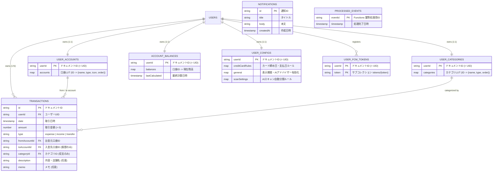

# 🗄️ Firestore データ構造 (Database Schema & E-R Diagram)

[← README に戻る](../README.md)

WalletWise Journal はデータベースに Cloud Firestore を採用しています。
ユーザー単位のマスター・設定ドキュメント（1:1）と、時系列の取引レコードコレクション（1:N）を組み合わせ、高速なクエリ性能とデータの整合性を両立させたスキーマ設計になっています。

---

## 📊 E-R ダイアグラム (Mermaid)

---

## 📁 コレクション一覧と詳細

### 1. `transactions`
ユーザーの全取引（支出・収入・口座間振替）を保存する主要コレクションです。
- **ドキュメントID**: 自動採番 UUID
- **セキュリティ**: ユーザー本人の UID と一致するデータのみ作成・読み取り・更新・削除が可能（[`firestore.rules`](../firestore.rules)）。

### 2. `user_accounts`
ユーザーごとの口座マスター（LUT: Lookup Table）を保持します。
- **ドキュメントID**: `userId`（1ユーザーにつき1ドキュメント）
- **内部マップ (`accounts`)**: 口座IDをキーとし、口座名、種別（`asset` / `liability`）、アイコン、ソート順、削除フラグ（論理削除）を格納。

### 3. `user_categories`
ユーザーごとの収支カテゴリマスターを保持します。
- **ドキュメントID**: `userId`（1ユーザーにつき1ドキュメント）
- **内部マップ (`categories`)**: カテゴリIDをキーとし、カテゴリ名、種別（`income` / `expense`）、ソート順、削除フラグを格納。

### 4. `account_balances`
各口座の最新残高を保持するキャッシュドキュメントです。
- **ドキュメントID**: `userId`
- **更新主体**: クライアントおよび Cloud Functions（サーバーサイド集計）
- **役割**: 取引履歴全件を都度集計することなく、高速にダッシュボード残高を描画するために利用。

### 5. `user_configs`
ユーザー固有の環境設定を保持します。
- **ドキュメントID**: `userId`
- **主な項目**:
  - `creditCardRules`: クレジットカードごとの締め日、支払日、引き落とし元口座、月オフセット設定
  - `general`: グラフ表示期間（月数）、AIアドバイザーの有効/無効
  - `scanSettings`: レシートAIスキャン時の自動カテゴリ分類ルール・除外設定

### 6. `user_fcm_tokens`
Web Push 通知（リマインダー）配信用の Firebase Cloud Messaging トークンを管理します。
- **ドキュメントID**: `userId`
- **サブコレクション**: `tokens/{token}`

### 7. `notifications`
システム全体のお知らせやメンテナンス情報を全ユーザー向けに配信するコレクションです。

### 8. `processed_events`
Cloud Functions（トリガー処理）の多重実行を防止するための冪等性管理用コレクションです。
- クライアントからの読み書きはセキュリティルールで完全に禁止されています。

---

[← README に戻る](../README.md)

