# 🎬 Live Demo & 📱 App Showcase (操作デモ動画 & 画面ギャラリー)

[← README に戻る](../README.md)

WalletWise Journal は、スマートフォン（iOS / Android）での片手操作に最適化した **PWA モバイル UI** と、大画面で資産状況を俯瞰できる **PC デスクトップ UI** の双方に対応したレスポンシブ設計を採用しています。

本ドキュメントでは、Playwright により自動収録された高精細な操作デモ動画（Retina 2x）と、主要画面のスクリーンショットを掲載しています。

---

## 🎬 操作デモ動画 (Live Demo)

Playwright により自動収録された、実際の操作アニメーションとスムーズな UX フローです。

| 📱 モバイル (iOS PWA) 操作フロー (786×1704 @2x Retina) | 💻 デスクトップ (PC) コックピット操作 (2880×1800 @2x Retina) |
| :---: | :---: |
| <video src="./videos/mobile_demo.webm" controls width="320" poster="./screenshots/mobile/01_dashboard.png"></video><br/><sub>[高画質動画を再生/ダウンロード (WebM)](./videos/mobile_demo.webm)</sub> | <video src="./videos/desktop_demo.webm" controls width="540" poster="./screenshots/desktop/02_dashboard_chart.png"></video><br/><sub>[高画質動画を再生/ダウンロード (WebM)](./videos/desktop_demo.webm)</sub> |
| **主な流れ**: 資産確認 → UFJ推移チャート展開 → レシートAIスキャン（Gemini 3.1 Flash Lite 解析・原本照合・即時反映） → AIアドバイザー診断 | **主な流れ**: ワイドコックピット俯瞰 → 年次・月次インタラクティブ分析 → 2カラム並列照合レシートスキャン登録 |

---

## 📱 画面ギャラリー (App Showcase)

### 💻 デスクトップ（PC）ビュー

| 資産ダッシュボード & 口座推移チャート | 収支レポート & クレカ支払予定 |
| :---: | :---: |
| 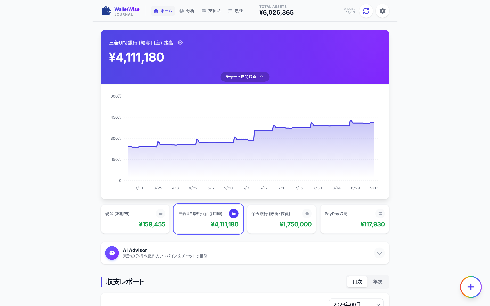 | 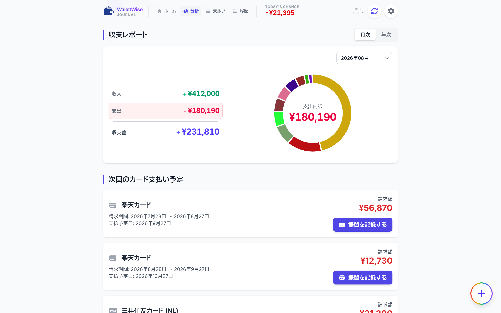 |
| **AI アドバイザーによる家計診断** | **Gemini 3.1 Flash Lite レシートAIスキャン照合** |
| 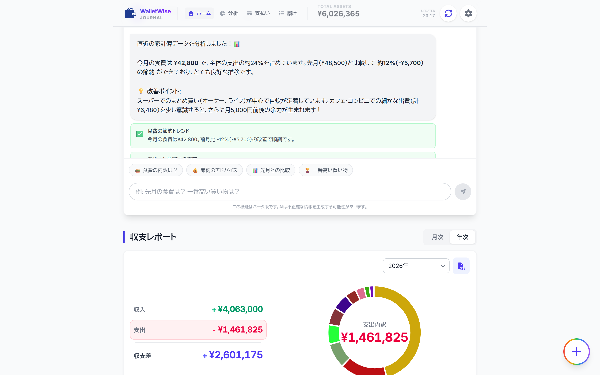 | 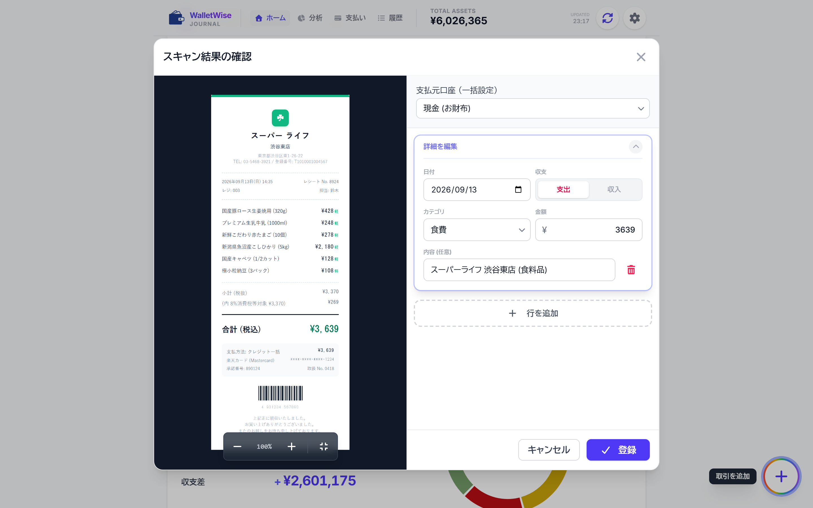 |

### 📱 モバイル（スマートフォン）ビュー

| ダッシュボード（純資産） | 口座推移チャート | クレカ支払予定リスト |
| :---: | :---: | :---: |
| 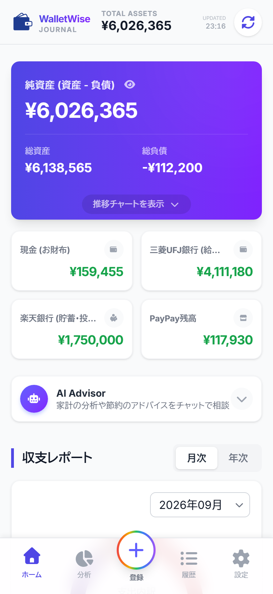 | 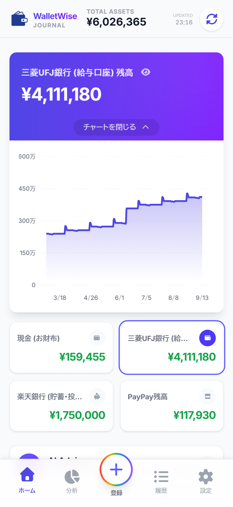 | 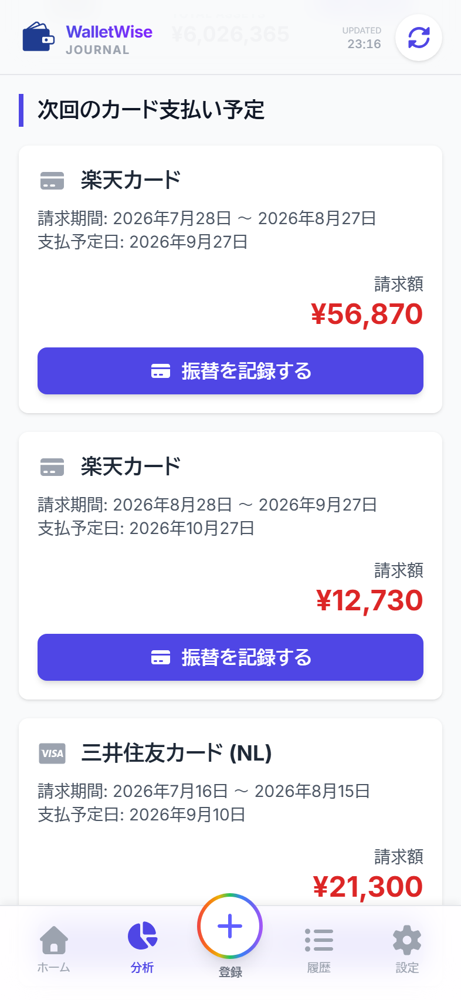 |

| 取引履歴タイムライン | 収支レポート（月次/年次） | AI アドバイザー相談 |
| :---: | :---: | :---: |
| 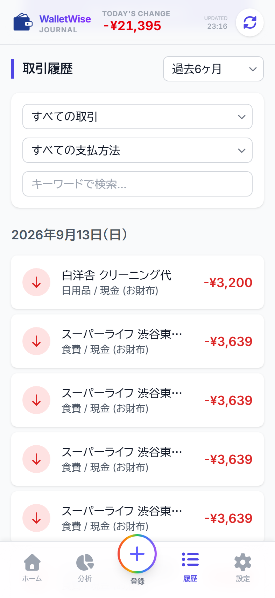 | 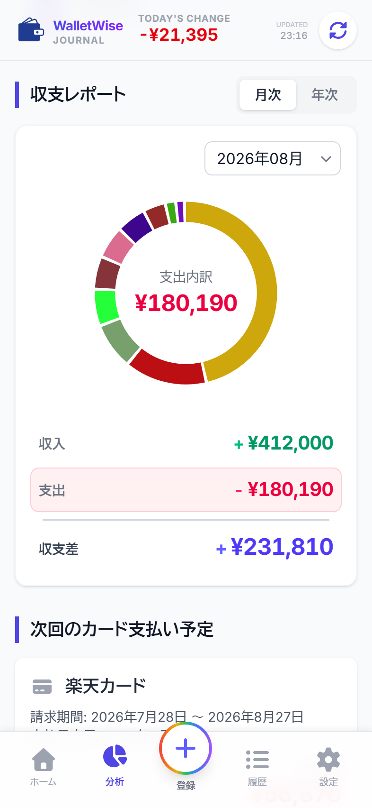 | 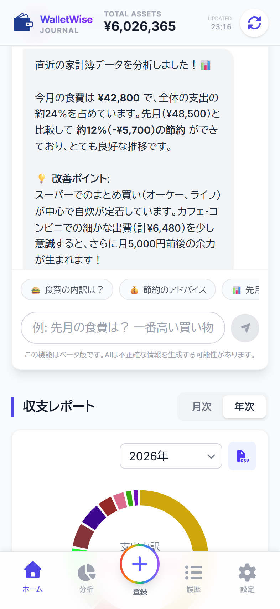 |

| 取引入力モーダル | Gemini AI 解析中 | スキャン結果の確認（自動入力） |
| :---: | :---: | :---: |
| 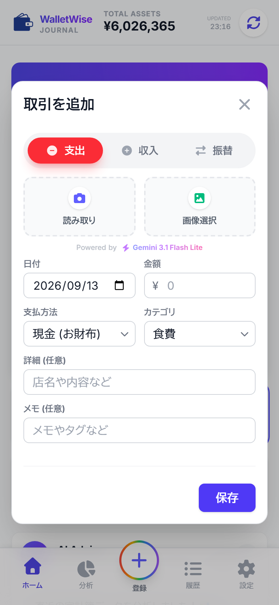 | 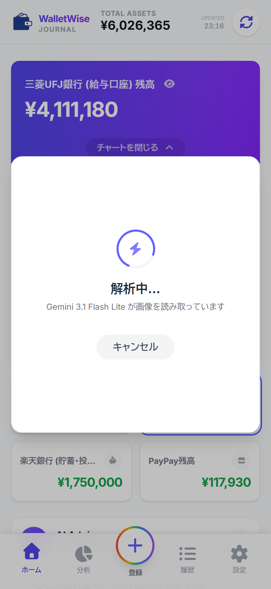 | 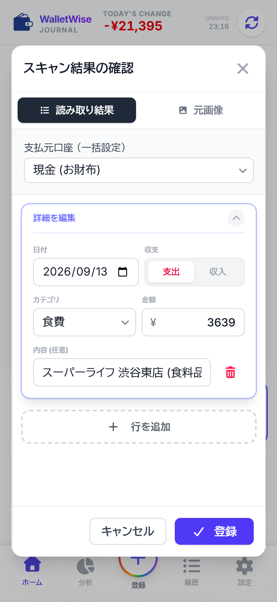 |

---

## 📸 スクリーンショット & 動画の再生成について

これらのメディアアセットは、すべて Playwright スクリプトにより自動生成・自動撮影が可能です。

```bash
# 1. デモ家計簿データ（12ヶ月分376件）の投入
npm run seed:demo

# 2. サンプルレシート画像の生成
npm run generate:receipt

# 3. 高解像度スクリーンショット（全21枚）の撮影
npm run capture:screenshots

# 4. 高解像度操作デモ動画（Retina 2x WebM）の自動収録
npm run record:videos
```

[← README に戻る](../README.md)
